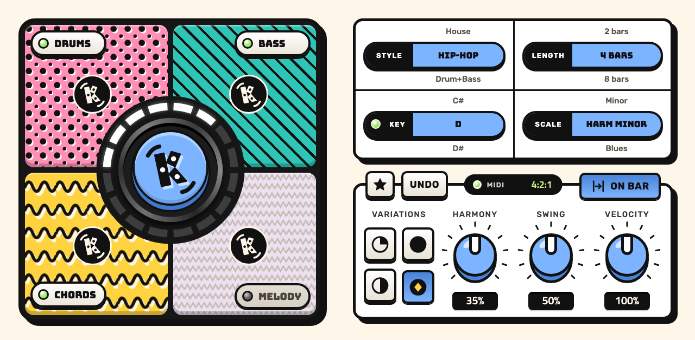
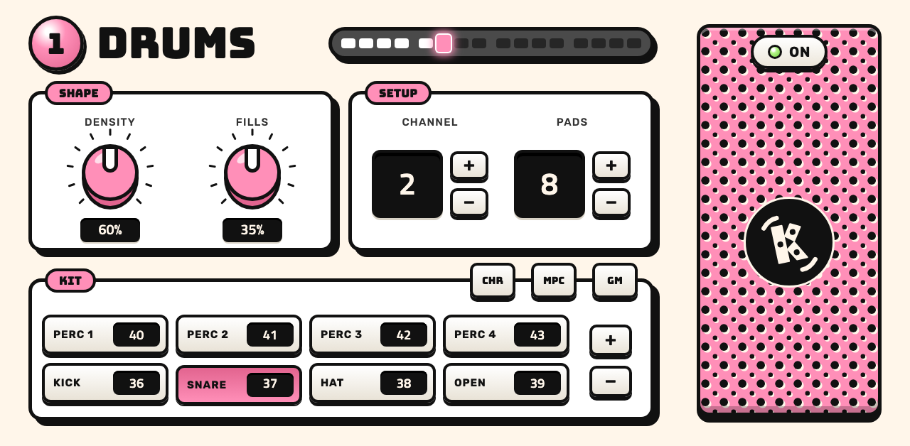

# Kwatuor (Kelta)

A four-track generative MIDI sequencer for the MPC. It makes no sound: each track sends notes
on its own MIDI channel through the plugin's MIDI port, and other MPC tracks play them.
The tracks are fixed: **Drums, Bass, Chords, Melody**. Press a quadrant to re-roll that track, or the
centre to re-roll all four.

Inspired by the idea behind Cyma Forma's RND synth (one button, a new musical idea), without the synth.

Needs MPC OS 3.10.1 or later with External plugins enabled (Preferences, Enhancements (Beta)).
Tested on an MPC XL; it should work on Gen 1 and Gen 2 MPCs, where it has not been tried. **4/4 only.**

## Setup on the MPC

1. Put Kwatuor on a plugin track. The tracks send on channels 2 to 5 (Drums, Bass, Chords, Melody), which leaves channel 1 to a keyboard; change **Channel** on a track's page if needed.
2. For each receiving track: MIDI input **Kwatuor**, the matching channel, monitor on.
   Channel 2 a drum program, 3 a bass, 4 a pad or keys, 5 a lead sound.
3. On the DRUMS page, set **Kit** to match the drum program: **MPC** for a standard MPC drum program, **GM** for a
   General MIDI kit, **CHR** for notes in a row from 36 (the default). Tap a cell to hear where a sound lands.
4. Press play, then press the centre of the square. The new idea starts on the next bar line;
   the button stays lit until then.

## Controls

**MAIN**: the square on the left, the shared settings on the right.

| Control | Values | Purpose |
|---|---|---|
| Quadrant | push | Re-roll that track (the shaking K badge marks it). Its pad keeps its pattern (at another size) for a variation and gets a new pattern for a new idea |
| Centre | push | The big shaking K: re-roll all four tracks |
| Name plate | switch | In each quadrant's corner: that track On or off. Off = the track sends nothing, and its pad is washed out |
| Style | Techno, House, Hip-hop, Drum+Bass, Trap, Dance/Pop, Reggae/Dub, Funk, Retro Game, Modern Game | Where each track tends to play, how often chords change, swing. Choosing a style also sets Gate and Long Notes on Bass, Chords and Melody to that style's values (a recalled Fav keeps its own) |
| Length | 1, 2, 4, 8 bars | Pattern length |
| Key | C..B | Root note. Tap the black KEY cap to switch **Key in** on: a note played into Kwatuor's track then sets Key (any octave, any channel) and the lens in the cap flashes |
| Scale | 20 scales | Major by default |
| Variations | four keys | How different a re-roll is: two variations (left column), two kinds of new idea (right column) |
| Harmony | 0..100 % | How much the shared chords move: one chord held at 0, more of the progression and passing chords as it rises. Bass, Chords and Melody follow it |
| Swing | 50..75 % | Delays every second 1/16; added to the style's own swing |
| ON BAR | switch | On the lower panel's edge, right. Blue: changes other than the re-rolls also wait for the bar line. Out: they act at once |
| Star | push | On the lower panel's edge, left: keep the current state as a Fav. Blue while the current state is a Fav, plain once anything changes, grey (and inactive) when all ten slots are full |
| UNDO | push | Beside the star: back to the state before the last re-roll or Fav recall (one level, on the bar line like a recall). It then reads REDO and comes forward again; a setting changed by hand turns it back to UNDO. It restores what a Fav holds |
| Velocity | 25..125 % | Scales every velocity |

| Variations key | Patterns | Shared harmony (centre button only) |
|---|---|---|
| Quarter pie | About one step in four changes | Kept |
| Half pie | About half the steps change | Kept |
| Full pie | New | Kept |
| Full pie with a diamond (the default) | New | New chord progression |

A quadrant never changes the harmony, whatever Variations says.

The ring of 16 lights round Generate is a bar clock: white for the steps played, sky blue for the steps still to
come while a change waits for the bar line, deep orange during a count-in (when nothing is sent). The MIDI readout
has a lens and the song position as bar:beat:step; when the MPC is not in 4/4 it shows the MPC's time signature with
a "!" instead. Touch the readout to stop sending, at once: the lens goes grey, the display reads OFF, the notes that
sound are ended, and the bar clock and the step strips stay dark. The re-rolls still work. Touch it again to send
(saved with the project, not in a Fav). A red lens and ERR mean the MIDI port did not open.

**DRUMS, BASS, CHORDS, MELODY**: one page per track, with only what that track uses.

| Control | On | Values | Purpose |
|---|---|---|---|
| Density | all | 0..100 % | How many of the style's possible steps play |
| Motion (Fills on Drums) | all | 0..100 % | Variation between bars, leaps, fills, extra percussion. That track only: chord movement is Harmony on MAIN |
| Gate | Bass, Chords, Melody | 5..100 % | Note length as a share of the gap to the next note; 100 % is legato. It cannot make a note outlast the next one: in a busy style, lower Density for longer notes |
| Long Notes | Bass, Chords, Melody | 0..100 % | Chance a note is a long one: it lasts a beat or two and swallows the notes that would fall inside it |
| Channel | all | 1..16 | MIDI channel |
| Pads | Drums | 4..8 | How many drum sounds play: kick, snare and the two hats always, plus up to four percussion (at most four hit on one step) |
| Kit | Drums | a note per sound | The note each of the eight drum sounds is sent on. Tap a cell to select and hear it, + and - move it, CHR / MPC / GM fill all eight, and the key stays lit until a note is moved. Cells beyond the Pads count are greyed |
| Octave | Bass, Chords, Melody | -3..+3 | 0 is the octave of middle C |
| Notes | Bass, Chords, Melody | 1..4 | Chord size; harmony notes on the melody; on the bass a fifth, the octave and the fifth above it |
| Mode | Bass, Chords, Melody | Loop, Drone | Drone: one long note per bar at most, no rhythm |
| Step strip | all | display | Beside the track name: the bar clock laid flat. The step that plays flashes in the track colour when the track starts a note on it |
| Tile | all | push | The pattern tile on the right re-rolls the track (the shaking K badge). At its top: the ON / OFF plate; a track that is off has its tile washed out |

For bar-long pads: Chords with Gate 100 % and low Density, or Mode Drone.
To play back what you recorded from Kwatuor without doubled notes, touch the MIDI readout on MAIN (or switch tracks off).

**FAV**: ten kept states. The star on MAIN keeps the current one: the four ideas, the harmony, Style, Key, Scale,
Length, Harmony, Swing, Velocity, every track's Shape and Setup values and the Kit (not Channel or On). It gets a
two-word name. Tap a tile to recall it on the next bar line (at once with On bar out); UNDO on MAIN takes a recall back.
EDIT, on the panel's top edge, shows a cross on each Fav: the cross removes it, for good, and while EDIT is lit a tile
does not recall. Favs are saved with the project. The version is printed small at the bottom right of this page.

**Q-Links on MAIN** (MPC XL, four banks left to right): Style, Length, Key, Scale / Variations, Harmony,
Swing, Velocity / the four re-rolls / the four On switches. The MPC keeps Q-Link assignments it has seen before: after a
change of this map an old project may show a mix until Kwatuor is added afresh.

## How it works

- A pattern is a pure function of seeds and settings (`src/engine.h`). Each track is a mosaic: every
  step belongs to one of up to eight seeds. A new idea gives all steps to one seed; a variation hands
  a share of the steps to a fresh seed. A project stores the seeds and the step maps.
- A style is a table (`kStyles`): weights for each 1/16 step of a bar (always, likely, unlikely, never) for
  three kick and snare variants, hats, three bass rows, chords and lead, plus how the bass relates to the kick,
  its note palette and lengths, which progressions the style likes and how its chords are voiced. Density turns
  weights into hits. These are rules written from what defines each genre, not patterns learned from recordings.
- All four tracks compute one shared plan from the harmony seed, the style and the length: the phrase form, a
  cadence weight per bar, who plays the turnaround, a chord per half bar, the kick skeleton. So the bass plays
  the chord's root on a change and locks to the kick, the tune puts chord tones on the beat and resolves at the
  end, and fills land where the phrase ends. A variation changes the same positions in every bar, so the form
  survives it.
- The kick skeleton belongs to that plan: a Drums re-roll changes snare, hats, percussion, fills and extra
  kicks; the centre button at Variations IV changes the main kick line too.
- MIDI leaves through an ALSA sequencer port, because the MPC discards a plugin's own MIDI output (`src/alsa_out.h`).
- The plugin (`src/Kwatuor.cpp`) has two threads of its own concern: the audio thread owns the ideas and plays
  them; a worker thread watches the keys, 40 times a second, and updates the displays. Keys and displays are
  hidden parameters, which is the only way a plugin's skin can talk to it.

## Building and testing

The skin is in `skins/` (images, `TUI.json`, `Q-Links.json`); the SDK build copies it verbatim. The fonts drawn
into the images are Bungee and Rubik (OFL).
To build you need inMusic's MPC plugin builder SDK (a separate download; clone it anywhere). Point `SDK` at it and
run from this folder:

    SDK=/path/to/mpc-plugin-builder-sdk
    python3 "$SDK/tools/build.py" .
    python3 "$SDK/tools/validate.py" .
    mkdir -p "build/Kelta - VST - Kwatuor/Presets" && cp presets/Default.xpl "build/Kelta - VST - Kwatuor/Presets/000-Default.xpl"

The last line adds the preset that the browser tile opens (Sounds > Instruments). The SDK build does not copy presets,
and it clears the output folder, so repeat it after every full build. `presets/Default.xpl` was saved on an MPC XL
with Kwatuor on the AKAI drive: it holds that path (`/media/AKAI/VST2 Plugins/...`), so it may not match elsewhere.

Tests, all on the Mac against the native build:

| Test | Checks |
|---|---|
| `tests/dump.cpp` | 623,000 generated patterns: in scale, voice limit, non-empty, and how each knob behaves (Dens only adds notes, Gate only lengthens, Notes nest, a re-roll of one track leaves the others alone) |
| `tests/metrics.cpp` | Musical measures per style with thresholds: chord tones on the beat, bass on the root at a chord change, kick and bass together, distinct bars, voice leading, cost |
| `tests/histhost.cpp` | A small VST host: Fav (keep, name, recall, Edit and remove, the star's states, save and load, the Kit in a Fav), Undo and Redo, the Variations keys, Gate and Long Notes following Style, Kit, Pads, Key in and its echo filter, On bar, the step strips, the 4/4 warning, MIDI Send |
| SDK `host_sim ... test --playing` | Every note-on gets its note-off |

## Limits

- 4/4 only. In another time signature Kwatuor keeps its 16-step bar and the MIDI readout shows a warning.
- Timing: notes leave once per audio block (about 3.7 ms of jitter on an MPC XL).
- Count-in: a note at the very start can occasionally be missed.
- CPU and memory: on an MPC XL with a four-track project, no cost that could be told from the same project without
  the plugin, and no memory growth.
- Not implemented: per-pad drum velocity, hat rolls faster than 1/16, more than one level of undo, naming a Fav by
  hand (the MPC's keyboard does not open for a plugin).
- The MIDI port is outside the SDK's host contract: a firmware update could break it.

## Licence

[PolyForm Noncommercial 1.0.0](LICENSE.md): you may use, change and share Kwatuor, source and graphics, for non-commercial purposes only. For anything commercial, ask Kelta.

Required Notice: Copyright 2026 Kelta (https://kwatuor.kelta.net)
